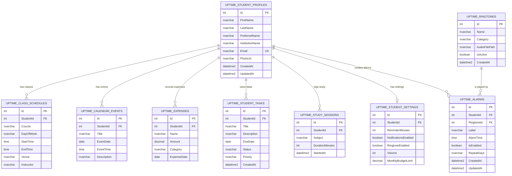

# Uptime — Database Design (ERD)

The Uptime database uses **nine tables** in Microsoft SQL Server 2022. Every feature table carries a `StudentId` foreign key that cascades on delete, so removing a student profile removes that student's data but nothing else.

- Schema file: `database/Uptime_SQLServer.sql`
- Live diagram: **Database & ERD → ERD** inside the app
- Mermaid export: **Database & ERD → Copy Mermaid** (paste into GitHub, GitLab, Notion or mermaid.live)
- Machine-readable snapshot: `GET /api/meta/schema`

---

## Entity-relationship diagram

**Cardinality summary**

| Relationship | Type | Notes |
| --- | --- | --- |
| Student → Classes | 1 : many | Cascade delete |
| Student → Events | 1 : many | Cascade delete |
| Student → Expenses | 1 : many | Cascade delete |
| Student → Tasks | 1 : many | Cascade delete |
| Student → Study sessions | 1 : many | Cascade delete |
| Student → Settings | 1 : 1 | `StudentId` is UNIQUE; cascade delete |
| Student → Alarms | 1 : many | Cascade delete |
| Ringtone → Alarms | 1 : many | `RESTRICT`: a ringtone cannot be deleted while an alarm uses it |

---

## Key design decisions

1. **One profile owns everything.** `UptimeStudentProfiles.Id` is the parent key. All feature tables return `404 Not Found` when the student ID is unknown, and every query filters by `StudentId`.
2. **Settings are one-to-one.** `UptimeStudentSettings.StudentId` has a `UNIQUE` constraint, so each student has at most one preferences row (reminder minutes, notifications, ringtone, volume, monthly budget limit).
3. **Ringtones are shared reference data.** Nine rows are seeded by the schema script and exposed read-only through `GET /api/ringtones`. The `RESTRICT` foreign key protects alarms from losing their sound.
4. **Constraints enforce valid data.**
   - `CK_UptimeClassSchedules_Day` allows only `Mon…Sun`.
   - `CK_UptimeClassSchedules_Time` requires `EndTime > StartTime`.
   - `CK_UptimeExpenses_Amount` requires a positive amount.
   - `CK_UptimeStudentTasks_Status` allows `Pending`, `In Progress`, `Completed`.
   - `CK_UptimeStudentTasks_Priority` allows `High`, `Normal`, `Low`.
   - `CK_UptimeStudySessions_Duration` limits a session to 1–1440 minutes.
   - `CK_UptimeAlarms_RepeatDays` allows only digits `1–7` and commas (ISO weekday list, e.g. `1,2,3,4,5`).
   - `CK_StudentSettings_Budget`, `CK_StudentSettings_Reminder` and `CK_StudentSettings_Volume` keep preferences in range.
5. **Indexes match the screens.**
   - Classes: `(StudentId, DayOfWeek, StartTime)` — weekly board and clash detection.
   - Events: `(StudentId, EventDate)` — month grid and `.ics` feed.
   - Expenses: `(StudentId, ExpenseDate)` — monthly totals and category meters.
   - Tasks: `(StudentId, DueDate)` — overdue and upcoming lists.
   - Sessions: `(StudentId, StartedAt)` — streak, 7-day chart and subject breakdown.
   - Alarms: `(StudentId, IsEnabled, AlarmTime)` — the 15-second alarm checker.
   - Profiles: unique index on `Email` where `Email IS NOT NULL`.
6. **Dates and times use SQL Server native types.** `date` for due dates and event dates, `time(0)` for class and alarm times, and `datetime2(6)` for created/started timestamps. The API exchanges `yyyy-MM-dd`, `HH:mm:ss` and ISO-8601 strings.
7. **Money uses `decimal(10,2)`.** No floating-point rounding errors in the budget.
8. **The database is never edited by hand for the demo.** Seeding and resetting go through `POST /api/demo/seed` and `POST /api/demo/reset`, which only touch the `demo@uptime.local` profile.

---

## Row ownership and security

- The application connects as `uptime_app`, a login role with `SELECT/INSERT/UPDATE/DELETE` on the application tables and `USAGE/SELECT` on sequences.
- The tables are owned by `uptime_owner`, a `NOLOGIN` role, and the setup script temporarily assumes that role to create objects.
- `uptime_app` is **not** a superuser and does not own the tables, so it cannot change the schema at runtime.
- The API has no authentication. It filters by the student ID in the URL but does not prove ownership, which is acceptable for a local classroom demo and unacceptable for the public internet.

---

## Reading the diagram in the app

1. Start the app and open **Database & ERD**.
2. The ERD tab draws the profile table as the root and every child table beneath it, with `PK` and `FK` markers.
3. **Copy Mermaid** copies the same diagram as text for a report or slide.
4. Switch to **Tables** to inspect actual rows, or **SQL Lab** to run the curated analytical queries:

| Query key | Question it answers |
| --- | --- |
| `budget-by-category` | Where is the money going this month? |
| `study-by-subject` | Which subject gets the most study time? |
| `timetable-load` | How packed is each weekday? |
| `upcoming-deadlines` | What is due next across all students? |
| `task-status-summary` | How many tasks are pending, in progress or complete? |
| `study-leaderboard` | Who studied the most minutes? |

All SQL Lab statements are fixed server-side; arbitrary SQL is never accepted over HTTP.
